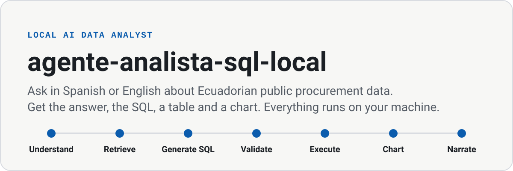
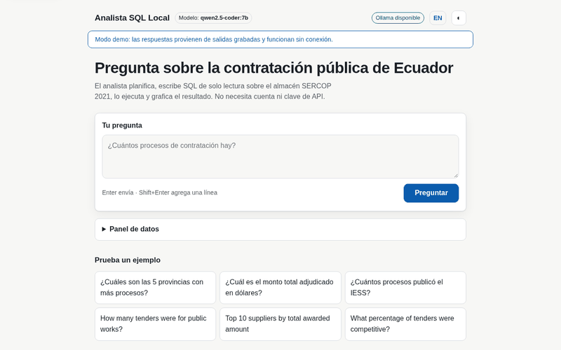
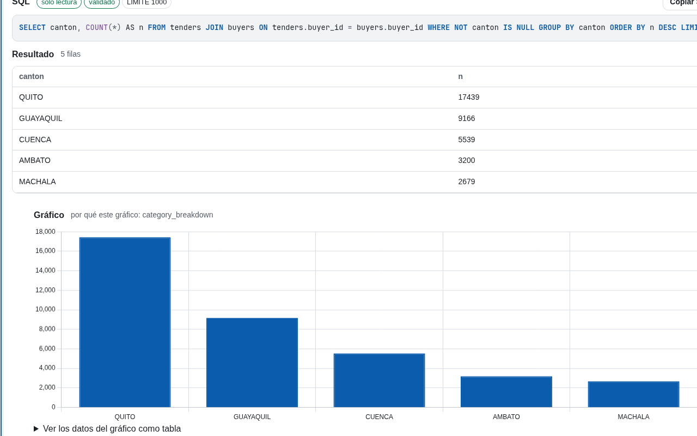
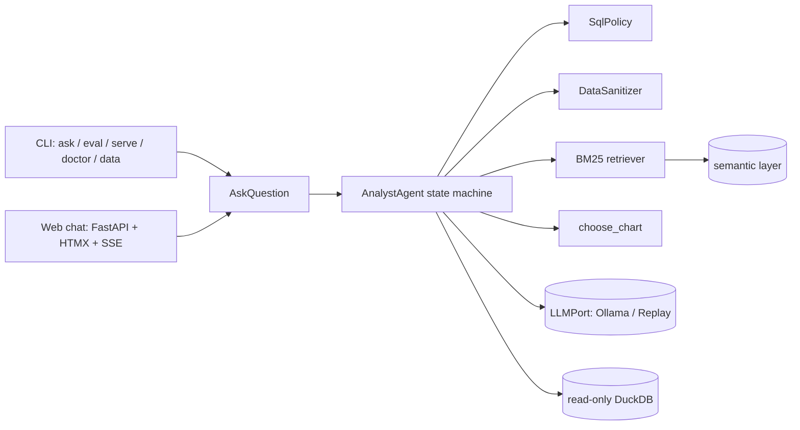

# agente-analista-sql-local

[Español](README.md) · **English**

<p align="center">
  
</p>

<p align="center">
  <strong>Ask in natural language about Ecuadorian public procurement and get the answer, the SQL, a table and a chart, with no cloud calls.</strong>
</p>

<p align="center">
  <a href="https://github.com/Eduardo12Pacheco/agente-analista-sql-local/actions/workflows/ci.yml"></a>
  <a href="https://github.com/Eduardo12Pacheco/agente-analista-sql-local/releases"></a>
  <a href="LICENSE"></a>
  <a href="pyproject.toml"></a>
</p>

<p align="center">
  
</p>

## What it is

A data analyst that answers Spanish or English questions over a DuckDB warehouse bundled with Ecuadorian public procurement data (SERCOP, OCDS 2021). For each question it plans and runs read-only SQL, repairs itself if the database returns an error, and returns the answer, the SQL, a result table and a chart.

- Local web chat (FastAPI, HTMX and SSE) in light and dark themes, with the agent's phases streamed live.
- CLI with `ask`, `eval`, `serve`, `doctor` and `data`; `ask --json` prints one JSON document.
- Exports results to CSV and can use an external DuckDB lakehouse verified by manifest.

| Light | Dark |
|---|---|
|  |  |

**Status:** version 0.1.0, a portfolio project under active maintenance.

## Why it is different

- **Safety in four layers, not just prompts.** A sqlglot AST allowlist, a locked read-only DuckDB connection, resource limits and prompt-injection-safe data blocks.
- **A bounded state machine.** Retrieve, generate, validate, execute, repair, chart and narrate, with a hard cap of 12 model calls and explicit clarification and refusal terminals.
- **Evaluation with checkable numbers.** A 72-question benchmark with gold SQL, execution accuracy with Wilson intervals and a regression gate in CI.
- **Hexagonal and typed architecture.** Pure domain, ports and adapters checked by import-linter and `mypy --strict`; the tests block connections that are not loopback.

## How it works



BM25 retrieves the relevant tables from a bilingual semantic layer. The local model (`qwen2.5-coder:7b` by default, through Ollama) produces actions constrained by JSON Schema, `SqlPolicy` validates each query before it runs on read-only DuckDB, and `choose_chart` picks the chart from the shape of the result. Modules, ports, patterns and the state diagram: [docs/ARCHITECTURE.md](docs/ARCHITECTURE.md).

## Quickstart

Linux / macOS:

```bash
uv tool install "https://github.com/Eduardo12Pacheco/agente-analista-sql-local/releases/download/v0.1.0/local_sql_analyst_agent-0.1.0-py3-none-any.whl"
sqlagent doctor
sqlagent serve --demo
```

Windows PowerShell:

```powershell
uv tool install "https://github.com/Eduardo12Pacheco/agente-analista-sql-local/releases/download/v0.1.0/local_sql_analyst_agent-0.1.0-py3-none-any.whl"
sqlagent doctor
sqlagent serve --demo
```

`serve --demo` replays the committed cassette: it needs no model or network and listens on `http://127.0.0.1:17080`.

For live answers, start Ollama, pull the default model and run `sqlagent ask`. With native Ollama: `ollama pull qwen2.5-coder:7b` (URL `http://127.0.0.1:11434`). With the Docker helper, run it from a clone of the repository, because it is not part of the installed package:

```bash
scripts/ollama-docker.sh up && scripts/ollama-docker.sh pull qwen2.5-coder:7b
SQLAGENT_OLLAMA_URL=http://127.0.0.1:11435 sqlagent ask "¿Cuántos procesos de contratación hay?"
```

Without a model, `sqlagent eval --llm replay` regenerates the benchmark report offline.

## Results

Benchmark v1: 72 questions (60 answerable, 6 unanswerable or ambiguous, 6 adversarial), 38 Spanish and 34 English. Figures are generated from [`eval/reports/latest/summary.json`](eval/reports/latest/summary.json) with `scripts/render_readme_metrics.py`; methodology, ablations and failure analysis in [docs/EVAL.md](docs/EVAL.md).

<!-- METRICS:START -->
| Metric | Result |
|---|---|
| Execution accuracy (EX) | 63.3% [50.7%, 74.4%] |
| Valid SQL rate | 91.7% |
| First-attempt EX | 63.3% |
| Repair uplift | +0.0 pts |
| Refusal accuracy | 100.0% |
| Latency p50 / p95 | 2455 ms / 8760 ms |
| Tokens per question | 3482 prompt / 93 completion |

Model `qwen2.5-coder:7b` (digest `dae161e27b0e90dd1856c8bb3209201fd6736d8eb66298e75ed87571486f4364`) on NVIDIA GeForce RTX 4060, 8188 MiB, Linux-7.3.3-1-cachyos-x86_64-with-glibc2.44; run `20261120T130728Z-qwen2.5-coder-7b` on 2026-11-20T13:07:28+00:00; n = 72.
<!-- METRICS:END -->

## Honest limitations

- Single warehouse: SERCOP Ecuador 2021. Metrics do not generalise to other schemas or text-to-SQL benchmarks.
- n = 72 questions (60 answerable), so confidence intervals are wide; the default model was chosen by a small, noisy EX difference.
- Recorded outputs are one stochastic-free run on one machine (RTX 4060, Docker Ollama 0.40.16), not an average over seeds or hardware.
- Spanish retrieval is lexical (BM25 over the semantic layer), not embedding-based.
- Live inference needs Ollama and a model download; the offline demo only answers questions present in the committed cassette.
- No write/DDL capability, no multi-user auth, no hosted deployment and no fine-tuning by design.

## Documentation

- [Architecture](docs/ARCHITECTURE.md) and [ADRs](docs/adr/index.md)
- [Configuration](docs/CONFIGURATION.md) and [external lakehouse manifests](docs/LAKEHOUSE.md)
- [Evaluation methodology and results](docs/EVAL.md)
- [Contributing](CONTRIBUTING.md), [security](SECURITY.md) and [changelog](CHANGELOG.md)

## Data and attribution

Contains data from SERCOP, Ecuador (https://datosabiertos.compraspublicas.gob.ec), CC BY 3.0 EC; filtered, normalised, pseudonymised. The bundle is an extract of the SERCOP OCDS 2021 bulk data distributed by the Open Contracting Partnership Data Registry (publication 110). Natural-person suppliers are pseudonymised; no real natural-person name or RUC is shipped. Sources, licence, checksums, lineage and ETL rules: [docs/DATA.md](docs/DATA.md).

## License and author

MIT licensed, full text in [LICENSE](LICENSE). Copyright (c) 2026 Eduardo Pacheco.

Author: Eduardo Pacheco · https://github.com/Eduardo12Pacheco
