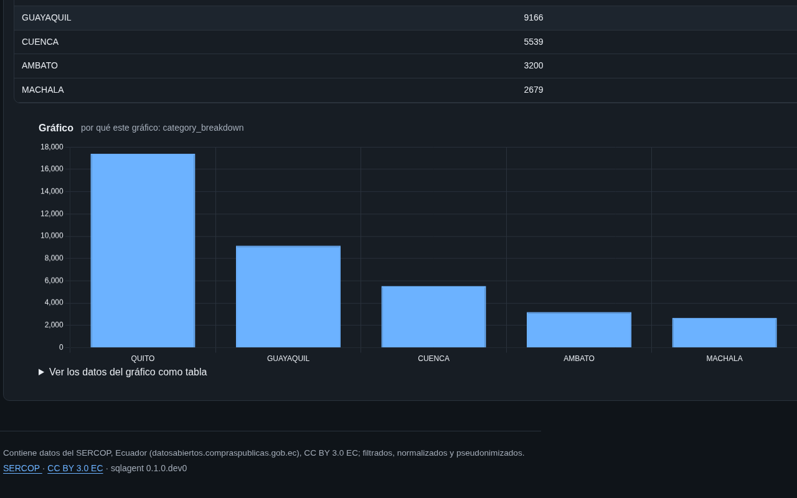
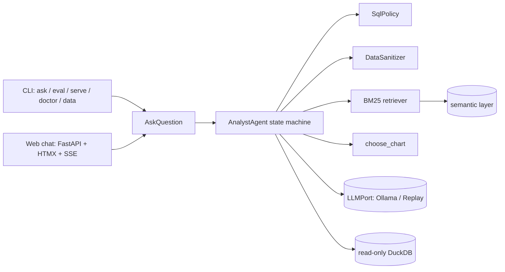

# agente-analista-sql-local

[Español](README.md) · **English**

[](https://github.com/Eduardo12Pacheco/agente-analista-sql-local/actions/workflows/ci.yml)
[](LICENSE)
[](pyproject.toml)
[](https://docs.astral.sh/uv/)
[](docs/ARCHITECTURE.md)

Local AI data analyst that answers Spanish and English questions over a bundled
DuckDB warehouse (Ecuador public procurement, SERCOP OCDS 2021), plans and executes
read-only SQL, self-corrects on database errors and returns an answer, the SQL, a
result table and a chart. Fully offline through recorded model outputs.


| Light | Dark |
|---|---|
|  |  |

## What it does

- Answers analytics questions in Spanish or English over six real procurement tables.
- Runs an explicit bounded state machine: retrieve → generate → validate → execute →
  repair → chart → narrate, with clarification and refusal terminals.
- Uses one local Ollama model (`qwen2.5-coder:7b`) through a JSON-schema-constrained
  action protocol; no API keys and no cloud calls.
- Shows the SQL it ran, a result table (≤ 200 rows in the UI), a chart chosen from the
  result shape and a trace of attempts, tokens, retrieved tables and guardrail events.
- Streams phases to a finished local web chat (FastAPI + HTMX + SSE) and offers the same
  flow in a script-friendly CLI with `--json`.
- Exports results to CSV and works with an external DuckDB lakehouse via a verified
  manifest.

## Why it is interesting

- **Safety engineering, not just prompting.** A sqlglot AST allowlist, a locked
  read-only DuckDB connection, resource limits and prompt-injection-safe data blocks
  protect the same boundary at four levels.
- **Evaluation engineering.** A versioned 72-question benchmark with gold SQL, execution
  accuracy and Wilson intervals, per-category/language/difficulty breakdowns, ablations,
  committed reports and a replay regression gate in CI.
- **Hexagonal and typed.** Pure domain, ports and adapters enforced by import-linter,
  `mypy --strict`, pydantic schemas and deterministic tests with no network.
- **Real data and honest numbers.** Ecuadorian SERCOP open data, pseudonymised natural
  persons, CC BY 3.0 EC attribution, and metrics generated from a committed summary.

## Architecture



Full module tree, ports, patterns and the state diagram: [docs/ARCHITECTURE.md](docs/ARCHITECTURE.md).

## Quickstart

Linux / macOS:

```bash
uv tool install "https://github.com/Eduardo12Pacheco/agente-analista-sql-local/releases/download/v0.1.0/local_sql_analyst_agent-0.1.0-py3-none-any.whl"
sqlagent doctor
sqlagent serve --demo
```

Windows PowerShell:

```powershell
uv tool install "https://github.com/Eduardo12Pacheco/agente-analista-sql-local/releases/download/v0.1.0/local_sql_analyst_agent-0.1.0-py3-none-any.whl"
sqlagent doctor
sqlagent serve --demo
```

`serve --demo` replays the committed cassette, so it needs no model and no network.
For live answers, start Ollama and pull the default model, then run `sqlagent ask`. The Docker helper is not part of the installed package: run these from a clone of https://github.com/Eduardo12Pacheco/agente-analista-sql-local:

```bash
scripts/ollama-docker.sh up && scripts/ollama-docker.sh pull qwen2.5-coder:7b
SQLAGENT_OLLAMA_URL=http://127.0.0.1:11435 sqlagent ask "¿Cuántos procesos de contratación hay?"
```

Native Ollama works too: `ollama pull qwen2.5-coder:7b` and the default
`http://127.0.0.1:11434`. Without a model, `sqlagent eval --llm replay` regenerates
the benchmark report offline.

## Results

Benchmark v1: 72 questions (60 answerable, 6 unanswerable/ambiguous, 6 adversarial), 38 Spanish / 34 English.
Numbers below are generated from [`eval/reports/latest/summary.json`](eval/reports/latest/summary.json) by
`scripts/render_readme_metrics.py`; see [docs/EVAL.md](docs/EVAL.md) for methodology, ablations and failure analysis.

<!-- METRICS:START -->
| Metric | Result |
|---|---|
| Execution accuracy (EX) | 63.3% [50.7%, 74.4%] |
| Valid SQL rate | 91.7% |
| First-attempt EX | 63.3% |
| Repair uplift | +0.0 pts |
| Refusal accuracy | 100.0% |
| Latency p50 / p95 | 2455 ms / 8760 ms |
| Tokens per question | 3482 prompt / 93 completion |

Model `qwen2.5-coder:7b` (digest `dae161e27b0e90dd1856c8bb3209201fd6736d8eb66298e75ed87571486f4364`) on NVIDIA GeForce RTX 4060, 8188 MiB, Linux-7.3.3-1-cachyos-x86_64-with-glibc2.44; run `20261120T130728Z-qwen2.5-coder-7b` on 2026-11-20T13:07:28+00:00; n = 72.
<!-- METRICS:END -->

## Data and attribution

Contains data from SERCOP, Ecuador (https://datosabiertos.compraspublicas.gob.ec), CC BY 3.0 EC;
filtered, normalised, pseudonymised. The bundle is an extract of the SERCOP OCDS 2021 bulk data
distributed by the Open Contracting Partnership Data Registry (publication 110). Natural-person
suppliers are pseudonymised; no real natural-person name or RUC is shipped. Sources, licence,
checksums, lineage and ETL rules: [docs/DATA.md](docs/DATA.md).

## Documentation

- [Architecture](docs/ARCHITECTURE.md) and [ADRs](docs/adr/index.md)
- [Data, licence and ETL](docs/DATA.md)
- [Evaluation methodology and results](docs/EVAL.md)
- [Configuration](docs/CONFIGURATION.md)
- [External lakehouse manifests](docs/LAKEHOUSE.md)
- [Contributing](CONTRIBUTING.md), [security](SECURITY.md), [changelog](CHANGELOG.md)

## Limitations

- Single warehouse: SERCOP Ecuador 2021. Metrics do not generalise to other schemas or
  text-to-SQL benchmarks.
- n = 72 questions (60 answerable), so confidence intervals are wide; the default model
  was chosen by a small, noisy EX difference.
- Recorded outputs are one stochastic-free run on one machine (RTX 4060, Docker
  Ollama 0.40.16), not an average over seeds or hardware.
- Spanish retrieval is lexical (BM25 over the semantic layer), not embedding-based.
- Live inference needs Ollama and a model download; the offline demo only answers
  questions present in the committed cassette.
- No write/DDL capability, no multi-user auth, no hosted deployment and no fine-tuning
  by design.

MIT licensed. Copyright (c) 2026 Eduardo Pacheco.
