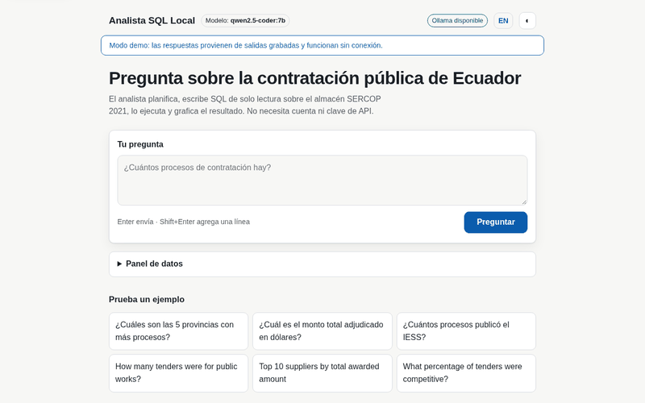
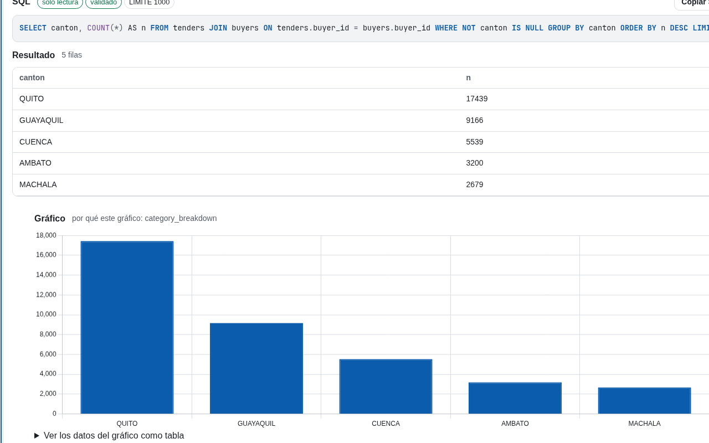
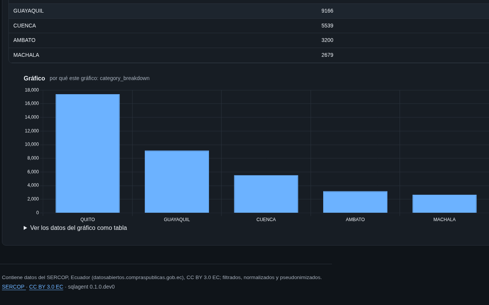
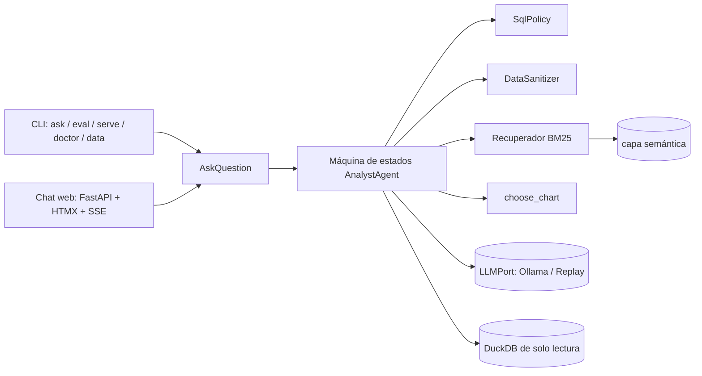

# local-sql-analyst-agent

[](https://github.com/Eduardo12Pacheco/local-sql-analyst-agent/actions/workflows/ci.yml)
[](LICENSE)
[](pyproject.toml)
[](https://docs.astral.sh/uv/)
[](docs/ARCHITECTURE.md)

Analista de datos con IA local que responde en español e inglés sobre un almacén DuckDB
incluido (SERCOP OCDS 2021 de Ecuador): planifica y ejecuta SQL de solo lectura, se
autocorrige y devuelve respuesta, SQL, tabla y gráfico. Funciona sin conexión con
salidas de modelo grabadas.



| Claro | Oscuro |
|---|---|
|  |  |

## Qué hace

- Responde preguntas analíticas en español o inglés sobre seis tablas reales de compras.
- Ejecuta una máquina de estados explícita y acotada: recuperar → generar → validar →
  ejecutar → reparar → graficar → narrar, con terminales de aclaración y rechazo.
- Usa un único modelo Ollama local (`qwen2.5-coder:7b`) con un protocolo de acciones
  restringido por JSON Schema; sin claves de API ni llamadas a la nube.
- Muestra SQL, tabla (≤ 200 filas), un gráfico elegido según la forma del resultado y una
  traza de intentos, tokens, tablas recuperadas y eventos de guardrail.
- Transmite fases a un chat web local (FastAPI + HTMX + SSE) y ofrece el flujo en CLI con `--json`.
- Exporta CSV y funciona con un lakehouse DuckDB externo verificado por manifiesto.

## Por qué es interesante

- **Seguridad, no solo prompts.** Lista blanca de AST, conexión DuckDB bloqueada y de solo
  lectura, límites de recursos y datos seguros ante inyección protegen la misma frontera.
- **Evaluación.** Benchmark de 72 preguntas con SQL de referencia, execution accuracy e
  intervalos de Wilson, desgloses, ablaciones, informes y una puerta de regresión en CI.
- **Hexagonal y tipado.** Dominio puro, puertos y adaptadores verificados por
  import-linter, `mypy --strict`, esquemas pydantic y pruebas deterministas sin red.
- **Datos reales y cifras honestas.** Datos abiertos de SERCOP Ecuador, personas
  naturales pseudonimizadas, atribución CC BY 3.0 EC y métricas generadas desde un
  resumen versionado.

## Arquitectura



Árbol de módulos, puertos, patrones y diagrama de estados:
[docs/ARCHITECTURE.md](docs/ARCHITECTURE.md).

## Inicio rápido

Linux / macOS:

```bash
uv tool install "https://github.com/Eduardo12Pacheco/local-sql-analyst-agent/releases/download/v0.1.0/local_sql_analyst_agent-0.1.0-py3-none-any.whl"
sqlagent doctor
sqlagent serve --demo
```

Windows PowerShell:

```powershell
uv tool install "https://github.com/Eduardo12Pacheco/local-sql-analyst-agent/releases/download/v0.1.0/local_sql_analyst_agent-0.1.0-py3-none-any.whl"
sqlagent doctor
sqlagent serve --demo
```

`serve --demo` reproduce la cassette versionada, así que no necesita modelo ni red.
Para respuestas en vivo, inicia Ollama, descarga el modelo por defecto y ejecuta
`sqlagent ask`. El asistente Docker no viene con el paquete instalado: ejecútalo desde un clon de https://github.com/Eduardo12Pacheco/local-sql-analyst-agent:

```bash
scripts/ollama-docker.sh up && scripts/ollama-docker.sh pull qwen2.5-coder:7b
SQLAGENT_OLLAMA_URL=http://127.0.0.1:11435 sqlagent ask "¿Cuántos procesos de contratación hay?"
```

Ollama nativo también funciona: `ollama pull qwen2.5-coder:7b` y la URL por defecto
`http://127.0.0.1:11434`. Sin modelo, `sqlagent eval --llm replay` regenera el informe
del benchmark sin conexión.

## Resultados

Benchmark v1: 72 preguntas (60 respondibles, 6 sin respuesta/ambiguas, 6 adversarias),
38 en español / 34 en inglés. Las cifras siguientes se generan desde
[`eval/reports/latest/summary.json`](eval/reports/latest/summary.json) con
`scripts/render_readme_metrics.py`; consulta [docs/EVAL.md](docs/EVAL.md) para
metodología, ablaciones y análisis de fallos.

<!-- METRICS:START -->
| Metric | Result |
|---|---|
| Execution accuracy (EX) | 63.3% [50.7%, 74.4%] |
| Valid SQL rate | 91.7% |
| First-attempt EX | 63.3% |
| Repair uplift | +0.0 pts |
| Refusal accuracy | 100.0% |
| Latency p50 / p95 | 2455 ms / 8760 ms |
| Tokens per question | 3482 prompt / 93 completion |

Model `qwen2.5-coder:7b` (digest `dae161e27b0e90dd1856c8bb3209201fd6736d8eb66298e75ed87571486f4364`) on NVIDIA GeForce RTX 4060, 8188 MiB, Linux-7.3.3-1-cachyos-x86_64-with-glibc2.44; run `20261120T130728Z-qwen2.5-coder-7b` on 2026-11-20T13:07:28+00:00; n = 72.
<!-- METRICS:END -->

## Datos y atribución

Contiene datos del SERCOP, Ecuador (https://datosabiertos.compraspublicas.gob.ec),
CC BY 3.0 EC; filtrados, normalizados y pseudonimizados. El paquete es un extracto de los
datos OCDS 2021 distribuidos por Open Contracting Partnership (publicación 110). Los
proveedores personas naturales están pseudonimizados; no se incluye ningún nombre ni RUC
real de persona natural. Fuentes, licencia, hashes, linaje y ETL: [docs/DATA.md](docs/DATA.md).

## Documentación

- [Arquitectura](docs/ARCHITECTURE.md) y [ADRs](docs/adr/index.md)
- [Datos, licencia y ETL](docs/DATA.md)
- [Metodología de evaluación y resultados](docs/EVAL.md)
- [Configuración](docs/CONFIGURATION.md)
- [Manifiestos de lakehouse externo](docs/LAKEHOUSE.md)
- [Contribuir](CONTRIBUTING.md), [seguridad](SECURITY.md), [changelog](CHANGELOG.md)
- [English](README.md)

## Limitaciones

- Un solo almacén: SERCOP Ecuador 2021. Las métricas no se generalizan a otros esquemas
  ni a benchmarks de text-to-SQL.
- n = 72 preguntas (60 respondibles), por lo que los intervalos de confianza son amplios;
  el modelo por defecto se eligió por una diferencia pequeña y ruidosa de EX.
- Las salidas grabadas son una única ejecución sin estocasticidad en una sola máquina
  (RTX 4060, Docker Ollama 0.40.16), no un promedio sobre semillas o hardware.
- La recuperación en español es léxica (BM25 sobre la capa semántica), no basada en
  embeddings.
- La inferencia en vivo necesita Ollama y descargar un modelo; la demo sin conexión solo
  responde preguntas presentes en la cassette versionada.
- Sin capacidad de escritura/DDL, sin autenticación multiusuario, sin despliegue alojado
  y sin fine-tuning por diseño.

Licencia MIT. Copyright (c) 2026 Eduardo Pacheco.
