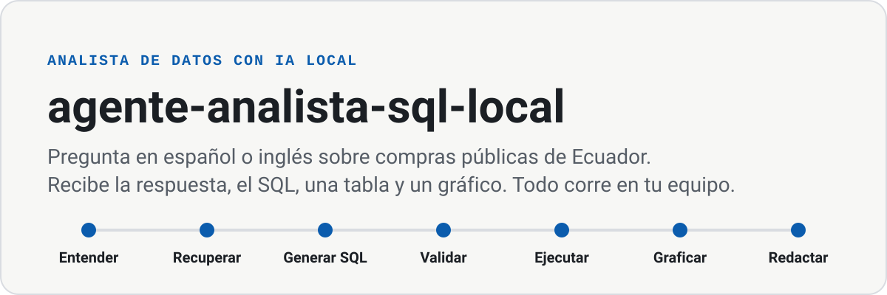
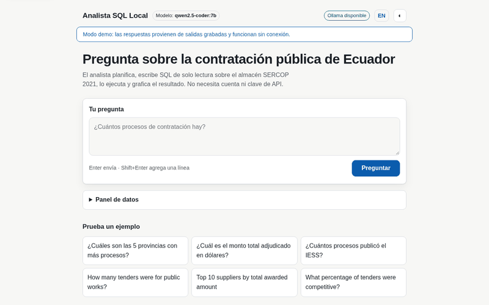
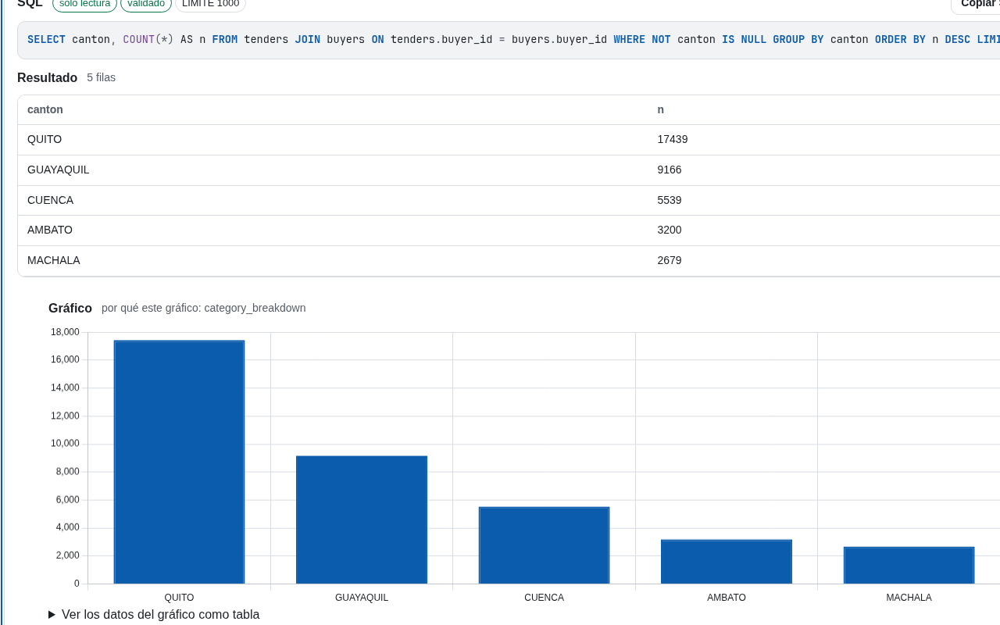
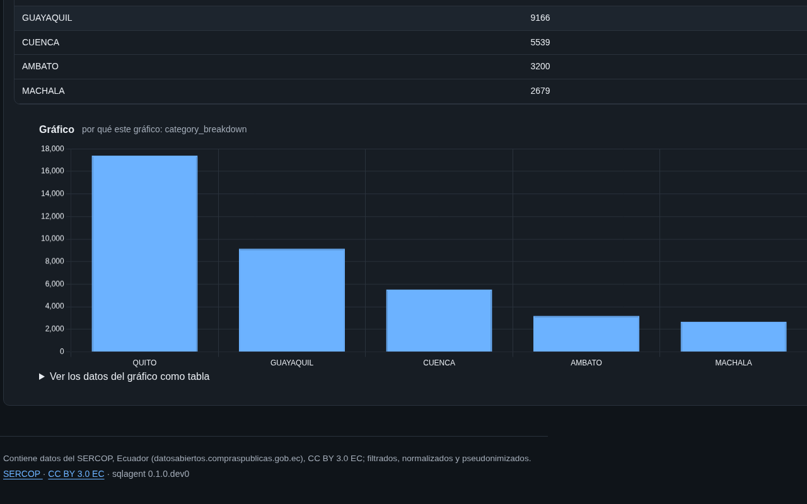
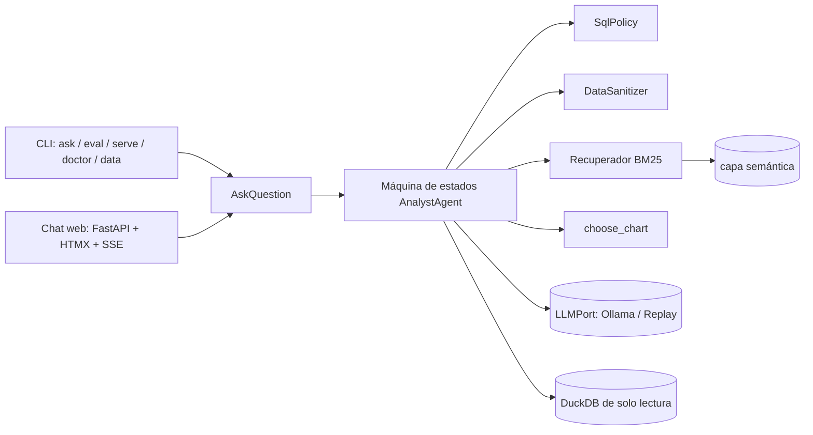

# agente-analista-sql-local

**Español** · [English](README.en.md)

<p align="center">
  
</p>

<p align="center">
  <strong>Pregunta en lenguaje natural sobre compras públicas de Ecuador y recibe la respuesta, el SQL, una tabla y un gráfico, sin llamadas a la nube.</strong>
</p>

<p align="center">
  <a href="https://github.com/Eduardo12Pacheco/agente-analista-sql-local/actions/workflows/ci.yml"></a>
  <a href="https://github.com/Eduardo12Pacheco/agente-analista-sql-local/releases"></a>
  <a href="LICENSE"></a>
  <a href="pyproject.toml"></a>
</p>

<p align="center">
  
</p>

## Qué es

Analista de datos que responde preguntas en español o inglés sobre un almacén DuckDB incluido con datos de compras públicas de Ecuador (SERCOP, OCDS 2021). Para cada pregunta planifica y ejecuta SQL de solo lectura, se corrige si la base de datos devuelve un error y entrega la respuesta, el SQL, una tabla de resultados y un gráfico.

- Interfaz web local (FastAPI, HTMX y SSE) en tema claro y oscuro, con las fases del agente en vivo.
- CLI con `ask`, `eval`, `serve`, `doctor` y `data`; `ask --json` imprime un único documento JSON.
- Exporta resultados a CSV y puede usar un lakehouse DuckDB externo verificado por manifiesto.

| Claro | Oscuro |
|---|---|
|  |  |

**Estado:** versión 0.1.0, proyecto de portafolio con mantenimiento activo.

## Por qué es distinto

- **Seguridad en cuatro niveles, no solo prompts.** Lista blanca de AST con sqlglot, conexión DuckDB bloqueada en solo lectura, límites de recursos y datos protegidos contra inyección de instrucciones.
- **Máquina de estados acotada.** Recuperar, generar, validar, ejecutar, reparar, graficar y narrar, con un tope de 12 llamadas al modelo y terminales explícitas de aclaración y rechazo.
- **Evaluación con cifras verificables.** Benchmark de 72 preguntas con SQL de referencia, execution accuracy con intervalos de Wilson y una puerta de regresión en CI.
- **Arquitectura hexagonal y tipada.** Dominio puro, puertos y adaptadores verificados con import-linter y `mypy --strict`; las pruebas bloquean conexiones que no sean de loopback.

## Cómo funciona



BM25 recupera las tablas relevantes de una capa semántica bilingüe. El modelo local (`qwen2.5-coder:7b` por defecto, vía Ollama) produce acciones restringidas por JSON Schema, `SqlPolicy` valida cada consulta antes de ejecutarla en DuckDB de solo lectura y `choose_chart` elige el gráfico según la forma del resultado. Módulos, puertos, patrones y diagrama de estados: [docs/ARCHITECTURE.md](docs/ARCHITECTURE.md).

## Inicio rápido

Linux / macOS:

```bash
uv tool install "https://github.com/Eduardo12Pacheco/agente-analista-sql-local/releases/download/v0.1.0/local_sql_analyst_agent-0.1.0-py3-none-any.whl"
sqlagent doctor
sqlagent serve --demo
```

Windows PowerShell:

```powershell
uv tool install "https://github.com/Eduardo12Pacheco/agente-analista-sql-local/releases/download/v0.1.0/local_sql_analyst_agent-0.1.0-py3-none-any.whl"
sqlagent doctor
sqlagent serve --demo
```

`serve --demo` reproduce la cassette versionada: no necesita modelo ni red y atiende en `http://127.0.0.1:17080`.

Para respuestas en vivo, inicia Ollama, descarga el modelo por defecto y ejecuta `sqlagent ask`. Con Ollama nativo: `ollama pull qwen2.5-coder:7b` (URL `http://127.0.0.1:11434`). Con el helper de Docker, ejecútalo desde un clon del repositorio, porque no viene en el paquete:

```bash
scripts/ollama-docker.sh up && scripts/ollama-docker.sh pull qwen2.5-coder:7b
SQLAGENT_OLLAMA_URL=http://127.0.0.1:11435 sqlagent ask "¿Cuántos procesos de contratación hay?"
```

Sin modelo, `sqlagent eval --llm replay` regenera el informe del benchmark sin conexión.

## Resultados

Benchmark v1: 72 preguntas (60 respondibles, 6 sin respuesta o ambiguas, 6 adversarias), 38 en español y 34 en inglés. Las cifras se generan desde [`eval/reports/latest/summary.json`](eval/reports/latest/summary.json) con `scripts/render_readme_metrics.py`; metodología, ablaciones y análisis de fallos en [docs/EVAL.md](docs/EVAL.md).

<!-- METRICS:START -->
| Metric | Result |
|---|---|
| Execution accuracy (EX) | 63.3% [50.7%, 74.4%] |
| Valid SQL rate | 91.7% |
| First-attempt EX | 63.3% |
| Repair uplift | +0.0 pts |
| Refusal accuracy | 100.0% |
| Latency p50 / p95 | 2455 ms / 8760 ms |
| Tokens per question | 3482 prompt / 93 completion |

Model `qwen2.5-coder:7b` (digest `dae161e27b0e90dd1856c8bb3209201fd6736d8eb66298e75ed87571486f4364`) on NVIDIA GeForce RTX 4060, 8188 MiB, Linux-7.3.3-1-cachyos-x86_64-with-glibc2.44; run `20261120T130728Z-qwen2.5-coder-7b` on 2026-11-20T13:07:28+00:00; n = 72.
<!-- METRICS:END -->

## Limitaciones honestas

- Un solo almacén: SERCOP Ecuador 2021. Las métricas no se generalizan a otros esquemas ni a benchmarks de text-to-SQL.
- n = 72 preguntas (60 respondibles), así que los intervalos de confianza son amplios; el modelo por defecto se eligió por una diferencia pequeña y ruidosa de EX.
- Las salidas grabadas son una única ejecución sin estocasticidad en una sola máquina (RTX 4060, Docker Ollama 0.40.16), no un promedio sobre semillas o hardware.
- La recuperación en español es léxica (BM25 sobre la capa semántica), no basada en embeddings.
- La inferencia en vivo necesita Ollama y descargar un modelo; la demo sin conexión solo responde preguntas presentes en la cassette versionada.
- Sin capacidad de escritura ni DDL, sin autenticación multiusuario, sin despliegue alojado y sin fine-tuning por diseño.

## Documentación

- [Arquitectura](docs/ARCHITECTURE.md) y [ADRs](docs/adr/index.md)
- [Configuración](docs/CONFIGURATION.md) y [manifiestos de lakehouse externo](docs/LAKEHOUSE.md)
- [Metodología de evaluación y resultados](docs/EVAL.md)
- [Contribuir](CONTRIBUTING.md), [seguridad](SECURITY.md) y [changelog](CHANGELOG.md)

## Datos y atribución

Contiene datos del SERCOP, Ecuador (https://datosabiertos.compraspublicas.gob.ec), CC BY 3.0 EC; filtrados, normalizados y pseudonimizados. El paquete es un extracto de los datos OCDS 2021 distribuidos por Open Contracting Partnership (publicación 110). Los proveedores personas naturales están pseudonimizados; no se incluye ningún nombre ni RUC real de persona natural. Fuentes, licencia, hashes, linaje y ETL: [docs/DATA.md](docs/DATA.md).

## Licencia y autor

Licencia MIT, texto completo en [LICENSE](LICENSE). Copyright (c) 2026 Eduardo Pacheco.

Autor: Eduardo Pacheco · https://github.com/Eduardo12Pacheco
