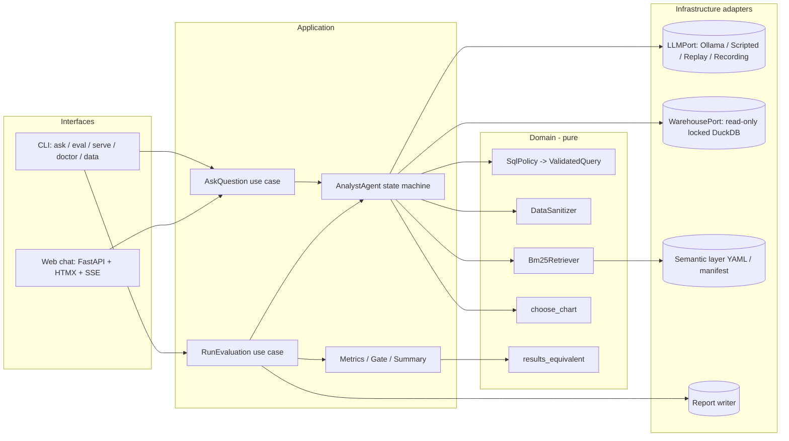
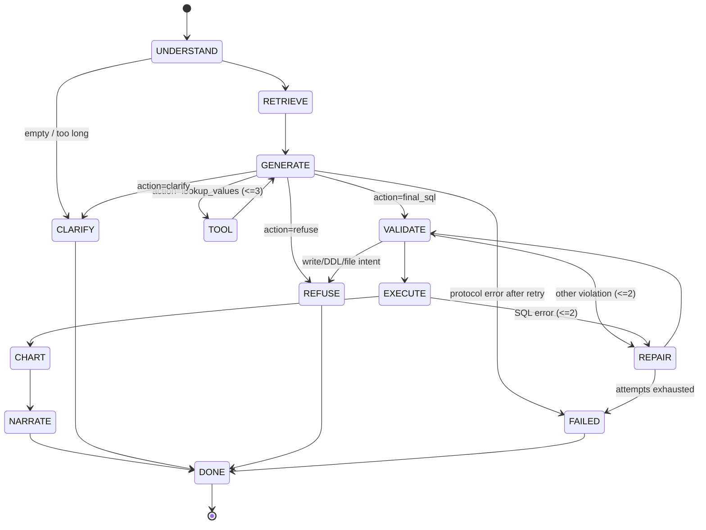

# Architecture

`local-sql-analyst-agent` is a local-first, hexagonal application in Python 3.12. The
domain is pure; the application layer orchestrates use cases through ports; adapters
provide the CLI, web UI, LLM backends, warehouse and repositories. Dependency direction
is enforced by import-linter contracts in `pyproject.toml` and by
`tests/architecture/test_import_contracts.py`.

> This is the T1 shell. The full architecture document (module tree, ports, patterns,
> defence in depth, extension guide) is completed in the release task.

## Layers

| Layer | Package | May import |
|---|---|---|
| Domain | `sqlagent.domain` | stdlib and `sqlglot` only |
| Application | `sqlagent.application` | `sqlagent.domain` only |
| Adapters | `sqlagent.adapters` | `sqlagent.domain`, `sqlagent.application` |
| Composition | `sqlagent.config`, `sqlagent.logging`, `sqlagent.bootstrap` | all layers (composition root) |

## System diagram

## Agent state machine

## Design patterns

To be documented with their concrete locations as the modules land: state machine
(handler table), chain of responsibility (SQL guard rules), parse-don't-validate
(`ValidatedQuery`), decorator (recording/replay LLMs), strategy (chart rules, LLM
backends), repository (semantic layer, benchmark), factory/composition root
(`bootstrap.py`), observer (`EventSink`), null object (`NullSink`) and record/replay
cassette testing.
