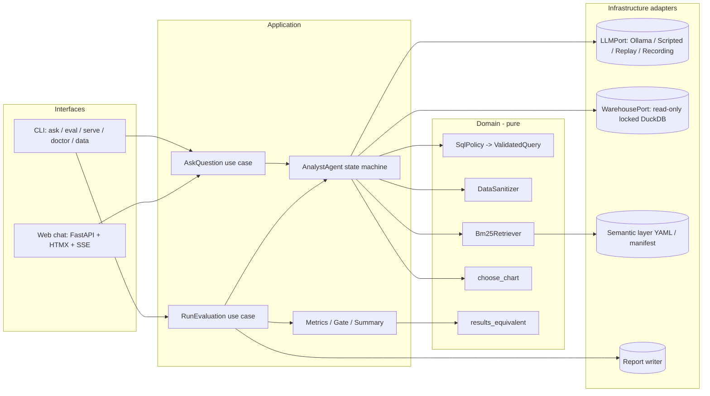
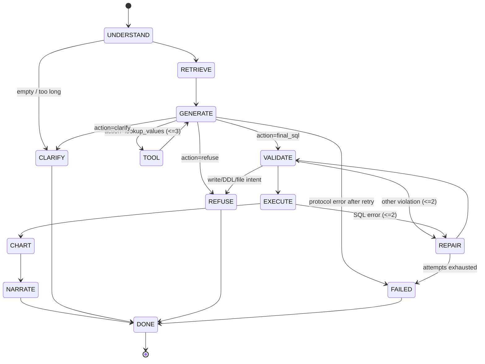

# Arquitectura

`local-sql-analyst-agent` es una aplicación Python 3.12 local-first y hexagonal. El dominio es
puro (biblioteca estándar más `sqlglot`); los casos de uso de la aplicación lo orquestan a través
de puertos; los adaptadores proporcionan la CLI, el chat web, los backends de LLM, el almacén y
los repositorios. La dirección de las dependencias la imponen los contratos de import-linter en
`pyproject.toml` y `tests/architecture/test_import_contracts.py`.

## Capas

| Capa | Paquete | Puede importar |
|---|---|---|
| Dominio | `sqlagent.domain` | solo la biblioteca estándar y `sqlglot` |
| Aplicación | `sqlagent.application` | solo `sqlagent.domain` |
| Adaptadores | `sqlagent.adapters` | `sqlagent.domain`, `sqlagent.application` |
| Composición | `sqlagent.config`, `sqlagent.logging`, `sqlagent.bootstrap` | todas las capas (raíz de composición) |

## Árbol de módulos

```
src/sqlagent/
├── __init__.py (__version__)  __main__.py  py.typed
├── config.py  logging.py  bootstrap.py        # typed settings, structlog, composition root
├── domain/                                     # pure: stdlib + sqlglot only
│   ├── models.py        # Language, Status, QueryResult, ChartSpec, AgentAnswer, Trace
│   ├── errors.py        # typed error hierarchy and GuardrailCode
│   ├── language.py      # ES/EN detection
│   ├── sql_policy.py    # SqlPolicy -> ValidatedQuery, ordered rule chain
│   ├── sanitize.py      # DataSanitizer for untrusted data blocks
│   ├── semantic.py      # semantic-layer dataclasses
│   ├── retrieval.py     # Bm25Retriever, tokenizer, few-shots
│   ├── chart.py         # choose_chart (ordered strategy rules)
│   └── equivalence.py   # results_equivalent (EX rule)
├── application/
│   ├── ports.py         # LLMPort, WarehousePort, repositories, EventSink
│   ├── agent/           # state machine, protocol, prompts, tools, events
│   ├── use_cases/       # AskQuestion, RunEvaluation
│   └── evaluation/      # benchmark, metrics, runner, gate, summary
├── adapters/
│   ├── llm/             # OllamaLLM, ScriptedLLM, ReplayLLM, RecordingLLM
│   ├── warehouse/       # ETL, materialiser, locked DuckDB, lakehouse adapter
│   ├── semantic/        # YAML, manifest and few-shot repositories
│   ├── benchmark/       # YAML benchmark repository
│   ├── reporting/       # Markdown, HTML and inline SVG
│   ├── web/             # FastAPI app, routes, SSE, i18n, templates, static assets
│   └── cli/             # Typer commands and rich rendering
└── resources/           # semantic layer, few-shots, Parquet bundle, benchmark, cassettes
```

## Puertos

| Puerto (`application/ports.py`) | Métodos | Adaptadores |
|---|---|---|
| `LLMPort` | `complete(LLMRequest) -> LLMResponse`; `describe() -> BackendInfo` | `OllamaLLM`, `ScriptedLLM`, `ReplayLLM`, `RecordingLLM` (decorador) |
| `WarehousePort` | `execute(ValidatedQuery)`; `lookup_values(...)`; `catalog()`; `info()` | `DuckDbWarehouse` (empaquetado/materializado o lakehouse externo) |
| `SemanticLayerRepository` | `load() -> SemanticLayer` | `YamlSemanticLayerRepository`, `ManifestSemanticLayerRepository` |
| `BenchmarkRepository` | `load(version) -> Benchmark` | `YamlBenchmarkRepository` |
| `ReportWriter` | `write(summary, results, out_dir)` | `MarkdownHtmlReportWriter` |
| `EventSink` | `emit(AgentEvent)` | `NullSink`, `CliProgressSink`, `QueueSink` (web) |

## Diagrama del sistema



## Máquina de estados del agente

El agente es una tabla explícita de manejadores sobre `Phase`, no un grafo de un framework
(ADR-0001). Todos los bucles están acotados: ≤ 3 llamadas a `lookup_values`, ≤ 2 reparaciones,
un reintento de protocolo por llamada al LLM y un tope de 12 llamadas al LLM por pregunta.



## Patrones de diseño

- **Puertos y adaptadores (hexagonal).** El dominio y la aplicación nunca importan DuckDB, httpx,
  FastAPI, Typer, YAML ni pydantic; la raíz de composición (`bootstrap.py`) elige los adaptadores
  a partir de la configuración tipada.
- **Máquina de estados.** `application/agent/machine.py` asocia cada `Phase` con un manejador, lo
  que mantiene auditables la terminación y los presupuestos.
- **Cadena de responsabilidad.** `domain/sql_policy.py` ejecuta reglas ordenadas (`LengthRule`,
  `ParseRule`, `RootRule`, `NodeRule`, `FunctionRule`, `TableRule`, `ComplexityRule`, `LimitRule`);
  gana el primer rechazo.
- **Analizar, no validar (*parse, don't validate*).** `ValidatedQuery` solo puede producirlo
  `SqlPolicy.validate`, transporta el SQL regenerado desde el AST y el límite efectivo, y es el
  único tipo de consulta que acepta `WarehousePort.execute`.
- **Decorador.** `RecordingLLM` y `ReplayLLM` envuelven otro `LLMPort` sin cambiar el agente.
- **Estrategia.** Las reglas de gráficos, el recuperador BM25 y los backends de LLM son
  implementaciones intercambiables tras un contrato pequeño.
- **Repositorio.** La capa semántica, el benchmark y los ejemplos few-shot se cargan desde
  recursos versionados mediante adaptadores de repositorio.
- **Fábrica / raíz de composición.** `bootstrap.py` construye los LLM, los almacenes y los
  agentes a partir de `Settings`.
- **Observador y objeto nulo.** `EventSink` recibe los `AgentEvent`; `NullSink` es el valor por
  defecto sin operación, y `QueueSink`/`ThreadEventSink` alimentan la interfaz web.
- **Pruebas con grabación y reproducción de cassettes.** Las llamadas reales al modelo se graban
  como JSONL indexado por un SHA-256 de la solicitud canónica; la reproducción recrea el uso y la
  latencia sin conexión y falla con `CassetteMiss` cuando cambia un prompt.

## Defensa en profundidad

La ruta del SQL está protegida en cuatro niveles independientes, de modo que saltarse uno no
concede escrituras ni acceso a archivos:

| Nivel | Mecanismo | Dónde |
|---|---|---|
| 1. Prompt | Instrucciones solo en `system`; los valores de la base de datos son bloques de datos no confiables | `application/agent/prompts.py` |
| 2. AST | Una única sentencia de solo lectura, listas blancas de nodos, funciones y tablas, complejidad y reescritura de `LIMIT` | `domain/sql_policy.py` |
| 3. Conexión | `read_only=True`, acceso externo desactivado, carga y autoinstalación de extensiones desactivadas, configuración bloqueada | `adapters/warehouse/duckdb_warehouse.py` |
| 4. Recursos | Tope de 1,000 filas, vigilancia de 20 s, límite de memoria de 2 GB, 4 hilos, bucles del agente acotados | `domain/models.py`, adaptador del almacén, máquina del agente |

Además, `DataSanitizer` elimina los caracteres de control, bidireccionales y de ancho cero,
neutraliza los imitadores de delimitadores, trunca celdas y filas, y marca los patrones de
inyección conocidos; el adaptador web escapa cada valor renderizado.

## Guía de extensión: añadir un backend de LLM en 3 pasos

1. Implementa `LLMPort` (`complete` y `describe`) en
   `src/sqlagent/adapters/llm/<backend>.py`. Reutiliza `LLMRequest`, `LLMResponse`,
   `LLMError` y los auxiliares de solicitud canónica; nunca importes el agente.
2. Devuelve el `content` de la respuesta como texto sin procesar. El agente analiza y valida la
   acción JSON plana, así que el adaptador no debe ejecutar SQL ni despachar herramientas.
3. Registra el backend en `bootstrap.build_llm` y añádelo a las opciones de `--llm` de la CLI
   (más el literal de configuración si es configurable). Añade el backend a
   `tests/contract/test_llm_port_contract.py`; la suite parametrizada es la prueba de
   aceptación del puerto.

Para un nuevo almacén, implementa `WarehousePort` y expón un `SemanticLayer`; `--manifest` es la
ruta externa compatible (véase `docs/LAKEHOUSE.md`).

## Documentos relacionados

- `docs/DATA.md`: conjunto de datos, licencia, ETL y hashes del paquete.
- `docs/EVAL.md`: benchmark, métricas, informes, puerta de regresión y resultados medidos.
- `docs/CONFIGURATION.md`: cada ajuste `SQLAGENT_*`.
- `docs/LAKEHOUSE.md`: contrato del manifiesto de almacén externo.
- `docs/adr/`: las nueve decisiones de arquitectura.
