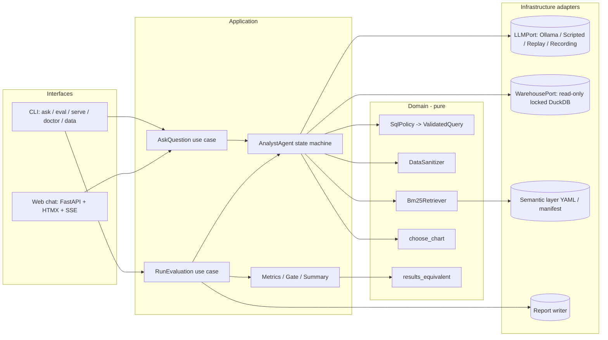
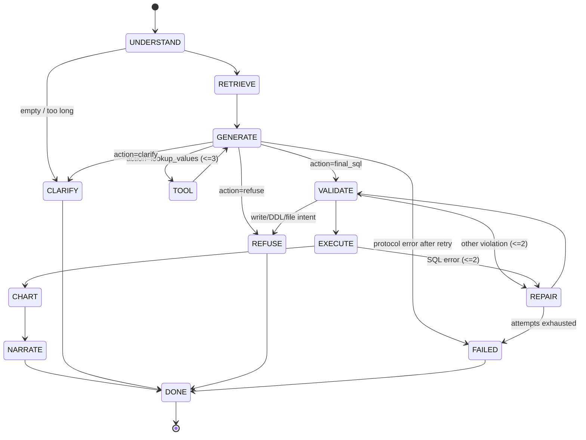

# Architecture

`local-sql-analyst-agent` is a local-first, hexagonal Python 3.12 application. The
domain is pure (stdlib plus `sqlglot`); application use cases orchestrate it
through ports; adapters provide the CLI, web chat, LLM backends, warehouse and
repositories. Dependency direction is enforced by import-linter contracts in
`pyproject.toml` and by `tests/architecture/test_import_contracts.py`.

## Layers

| Layer | Package | May import |
|---|---|---|
| Domain | `sqlagent.domain` | stdlib and `sqlglot` only |
| Application | `sqlagent.application` | `sqlagent.domain` only |
| Adapters | `sqlagent.adapters` | `sqlagent.domain`, `sqlagent.application` |
| Composition | `sqlagent.config`, `sqlagent.logging`, `sqlagent.bootstrap` | all layers (composition root) |

## Module tree

```
src/sqlagent/
├── __init__.py (__version__)  __main__.py  py.typed
├── config.py  logging.py  bootstrap.py        # typed settings, structlog, composition root
├── domain/                                     # pure: stdlib + sqlglot only
│   ├── models.py        # Language, Status, QueryResult, ChartSpec, AgentAnswer, Trace
│   ├── errors.py        # typed error hierarchy and GuardrailCode
│   ├── language.py      # ES/EN detection
│   ├── sql_policy.py    # SqlPolicy -> ValidatedQuery, ordered rule chain
│   ├── sanitize.py      # DataSanitizer for untrusted data blocks
│   ├── semantic.py      # semantic-layer dataclasses
│   ├── retrieval.py     # Bm25Retriever, tokenizer, few-shots
│   ├── chart.py         # choose_chart (ordered strategy rules)
│   └── equivalence.py   # results_equivalent (EX rule)
├── application/
│   ├── ports.py         # LLMPort, WarehousePort, repositories, EventSink
│   ├── agent/           # state machine, protocol, prompts, tools, events
│   ├── use_cases/       # AskQuestion, RunEvaluation
│   └── evaluation/      # benchmark, metrics, runner, gate, summary
├── adapters/
│   ├── llm/             # OllamaLLM, ScriptedLLM, ReplayLLM, RecordingLLM
│   ├── warehouse/       # ETL, materialiser, locked DuckDB, lakehouse adapter
│   ├── semantic/        # YAML, manifest and few-shot repositories
│   ├── benchmark/       # YAML benchmark repository
│   ├── reporting/       # Markdown, HTML and inline SVG
│   ├── web/             # FastAPI app, routes, SSE, i18n, templates, static assets
│   └── cli/             # Typer commands and rich rendering
└── resources/           # semantic layer, few-shots, Parquet bundle, benchmark, cassettes
```

## Ports

| Port (`application/ports.py`) | Methods | Adapters |
|---|---|---|
| `LLMPort` | `complete(LLMRequest) -> LLMResponse`; `describe() -> BackendInfo` | `OllamaLLM`, `ScriptedLLM`, `ReplayLLM`, `RecordingLLM` (decorator) |
| `WarehousePort` | `execute(ValidatedQuery)`; `lookup_values(...)`; `catalog()`; `info()` | `DuckDbWarehouse` (bundled/materialised or external lakehouse) |
| `SemanticLayerRepository` | `load() -> SemanticLayer` | `YamlSemanticLayerRepository`, `ManifestSemanticLayerRepository` |
| `BenchmarkRepository` | `load(version) -> Benchmark` | `YamlBenchmarkRepository` |
| `ReportWriter` | `write(summary, results, out_dir)` | `MarkdownHtmlReportWriter` |
| `EventSink` | `emit(AgentEvent)` | `NullSink`, `CliProgressSink`, `QueueSink` (web) |

## System diagram



## Agent state machine

The agent is an explicit handler table over `Phase`, not a framework graph
(ADR-0001). Every loop is bounded: ≤ 3 `lookup_values` calls, ≤ 2 repairs, one
protocol retry per LLM call and a hard cap of 12 LLM calls per question.



## Design patterns

- **Hexagonal ports and adapters.** The domain and application never import
  DuckDB, httpx, FastAPI, Typer, YAML or pydantic; the composition root
  (`bootstrap.py`) chooses adapters from typed settings.
- **State machine.** `application/agent/machine.py` maps each `Phase` to a
  handler, keeping termination and budgets auditable.
- **Chain of responsibility.** `domain/sql_policy.py` runs ordered rules
  (`LengthRule`, `ParseRule`, `RootRule`, `NodeRule`, `FunctionRule`,
  `TableRule`, `ComplexityRule`, `LimitRule`); the first rejection wins.
- **Parse, don't validate.** `ValidatedQuery` can only be produced by
  `SqlPolicy.validate`, carries the regenerated AST SQL and the effective limit,
  and is the only query type `WarehousePort.execute` accepts.
- **Decorator.** `RecordingLLM` and `ReplayLLM` wrap another `LLMPort` without
  changing the agent.
- **Strategy.** Chart rules, the BM25 retriever and LLM backends are
  interchangeable implementations behind a small contract.
- **Repository.** The semantic layer, benchmark and few-shots are loaded from
  versioned resources through repository adapters.
- **Factory / composition root.** `bootstrap.py` builds LLMs, warehouses and
  agents from `Settings`.
- **Observer and null object.** `EventSink` receives `AgentEvent`s; `NullSink`
  is the no-op default and `QueueSink`/`ThreadEventSink` feed the web UI.
- **Record/replay cassette testing.** Real model calls are recorded as JSONL
  keyed by a SHA-256 of the canonical request; replay reproduces usage and
  latency offline and fails with `CassetteMiss` when a prompt changed.

## Defence in depth

The SQL path is protected at four independent levels so bypassing one does not
grant writes or file access:

| Level | Mechanism | Where |
|---|---|---|
| 1. Prompt | Instructions only in `system`; DB values are untrusted data blocks | `application/agent/prompts.py` |
| 2. AST | Single read-only statement, node/function/table allowlists, complexity and LIMIT rewrite | `domain/sql_policy.py` |
| 3. Connection | `read_only=True`, external access off, extension autoload/autoinstall off, configuration locked | `adapters/warehouse/duckdb_warehouse.py` |
| 4. Resources | 1,000-row cap, 20 s watchdog, 2 GB memory limit, 4 threads, bounded agent loops | `domain/models.py`, warehouse adapter, agent machine |

On top of that, `DataSanitizer` strips control/bidi/zero-width characters,
neutralises delimiter look-alikes, truncates cells and rows, and flags known
injection patterns; the web adapter escapes every rendered value.

## Extension guide: add a new LLM backend in 3 steps

1. Implement `LLMPort` (`complete` and `describe`) in
   `src/sqlagent/adapters/llm/<backend>.py`. Reuse `LLMRequest`, `LLMResponse`,
   `LLMError` and the canonical request helpers; never import the agent.
2. Return the response `content` as raw text. The agent parses and validates the
   flat JSON action, so the adapter must not execute SQL or dispatch tools.
3. Register the backend in `bootstrap.build_llm` and add it to the CLI
   `--llm` choices (plus the settings literal if it is configurable). Add the
   backend to `tests/contract/test_llm_port_contract.py`; the parametrised suite
   is the acceptance test for the port.

For a new warehouse, implement `WarehousePort` and expose a `SemanticLayer`;
`--manifest` is the supported external path (see `docs/LAKEHOUSE.md`).

## Related documents

- `docs/DATA.md`: dataset, licence, ETL, bundle hashes.
- `docs/EVAL.md`: benchmark, metrics, reports, gate and measured results.
- `docs/CONFIGURATION.md`: every `SQLAGENT_*` setting.
- `docs/LAKEHOUSE.md`: external warehouse manifest contract.
- `docs/adr/`: the nine architecture decisions.
