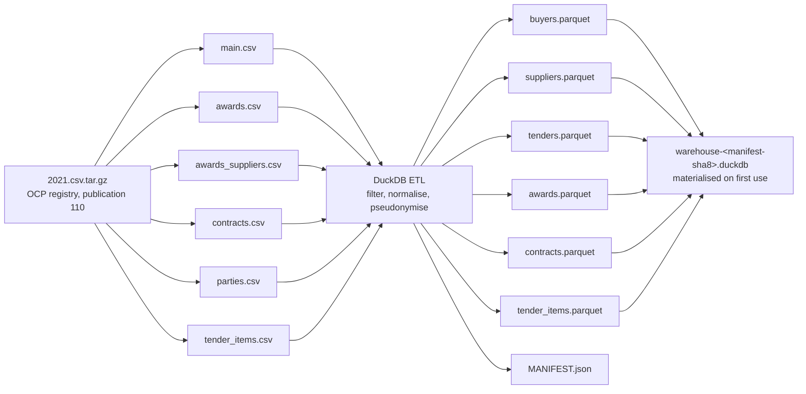

# Data: SERCOP Ecuador OCDS 2021

The bundled warehouse is a filtered, normalised and pseudonymised extract of the
Ecuadorian public-procurement system (SERCOP) for 2021. It ships as six Parquet
files plus `MANIFEST.json` inside the wheel, so the application works offline on
first run.

> Contains data from SERCOP, Ecuador (https://datosabiertos.compraspublicas.gob.ec),
> CC BY 3.0 EC; filtered, normalised, pseudonymised.

## Source and licence

| Field | Value |
|---|---|
| Publisher | Servicio Nacional de Contratación Pública (SERCOP), Ecuador |
| Dataset | OCDS bulk data, CSV flavour, year 2021 |
| Distribution | Open Contracting Partnership Data Registry, publication 110 |
| URL | https://data.open-contracting.org/en/publication/110/download?name=2021.csv.tar.gz |
| Licence | CC BY 3.0 Ecuador — https://creativecommons.org/licenses/by/3.0/ec/ |
| Attribution link | https://datosabiertos.compraspublicas.gob.ec |
| Tarball SHA-256 | `e1fbc3c855a4c85f2077542cbce977ab5ac882fc11744f7042bc81d5a8f426fe` |

The publisher's publication policy (section 6) allows use and republication for
any purpose provided a link to the original source is included. The policy also
excludes phone numbers, supplier size and the SIE reference budget; this bundle
does not contain those fields.

The tarball is regenerated upstream from time to time, so the reproducible pin
is the SHA-256 of the six consumed CSV members:

| Member | CSV records | SHA-256 |
|---|---:|---|
| `main.csv` | 122,277 | `eb3c05fdf955dbd3879e372f3e6ce54f7f8b199efd45bb355d754aeba3e53f00` |
| `awards.csv` | 121,736 | `2622dbe34c5ab30a6b93de76b817884ad19484ee6557957faf8e73897beefe4d` |
| `awards_suppliers.csv` | 121,736 | `cbfaae3cf405fccf72d4de9e31003b96ee19323eb5f7bd0e31965d194fe0d4ab` |
| `contracts.csv` | 117,492 | `6d944118c5d0876279033dd39e9c842df20be759cb5ef4faedc7b720e12b71ee` |
| `parties.csv` | 293,287 | `5da114e85818189bc63b623b6fd2863443247f6097726e72d065054db0cc0da8` |
| `tender_items.csv` | 49,628 | `0844e18c3d1e7b15bbfb63609d1ba83d059c6eab44d83546802803c7a5ae0fe8` |

## Bundle

| Table | Rows | Parquet SHA-256 |
|---|---:|---|
| `buyers` | 2,641 | `66f7e1f6cde4f95ee205fd91936fa8c367bf8f7c2d4557c2ef1894234f8f49d0` |
| `suppliers` | 10,217 | `e054a56a78f9a0cbe84f6e069b7b37d6e0b89d8797ad5689111dce9e4d64e95a` |
| `tenders` | 121,072 | `f3abd034f4ce111da656a655beace09e7af1130db33eab7fe155c28db06684e6` |
| `awards` | 121,736 | `1102c411fd998c9612915ad87dafb263b3998593d8268cd64b4788ba421846bf` |
| `contracts` | 117,492 | `f64cb7185bd8845fa0ab4e9e79055cd0a6b3f1c4dd30449287190044a5a29936` |
| `tender_items` | 49,628 | `d4317aac062ab31d1258a57529ca602c5e7a3d771594a510f509ad30bb40460a` |

Total Parquet size is about 4.3 MB (well under the 8 MB budget). Every file is
zstd level 19, written from a single-threaded DuckDB session and ordered by its
key so rebuilds are reproducible. `MANIFEST.json` additionally records row
counts and fingerprints (sum of the monetary column in cents and distinct key
count); `sqlagent data verify` recomputes all of them.

## Lineage



## Schema

```
buyers(buyer_id PK, buyer_name, province, canton)
suppliers(supplier_id PK, supplier_name, supplier_kind, province, canton)
tenders(tender_id PK, process_code, release_date, buyer_id FK→buyers, title,
        description, procurement_method, procurement_type, method_details,
        category, status, planned_amount_usd, number_of_tenderers, is_competitive)
awards(tender_id FK→tenders, award_id, supplier_id FK→suppliers, amount_usd,
       status, PK(tender_id, award_id))
contracts(contract_id, tender_id FK→tenders, award_id, status, amount_usd,
          signed_date, duration_days)
tender_items(item_id PK, tender_id FK→tenders, description, quantity, unit_name,
             unit_price_usd, cpc_code, cpc_description)
```

Parquet carries no constraints. On first use the materialiser creates a
read-only DuckDB database in the user data directory with primary and foreign
keys declared; a test checks there are no orphan rows.

## ETL rules

1. Read all six CSVs as `VARCHAR` (`all_varchar=true`, `sample_size=-1`).
2. Keep only `main` rows with a non-NULL `tender_status` (drops 1,205
   planning-only releases).
3. Normalise every string: trim and collapse whitespace runs to one space.
4. `tenders.tender_id` is the OCDS `ocid`; `process_code` is the two
   dash-separated tokens after the `ocds-<publisher>-` prefix
   (`ocds-5wno2w-CE-20210001947751-115480` → `CE-20210001947751`).
5. `buyer_id` is the 13-digit RUC extracted from `EC-RUC-…`; buyer
   province/canton come from the buyer `parties` row.
6. `procurement_type` is a closed mapping: Catálogo electrónico →
   `catalogo_electronico`; Subasta Inversa Electrónica → `subasta_inversa`;
   Menor Cuantía → `menor_cuantia`; Cotización → `cotizacion`; the three direct
   contracting variants → `contratacion_directa`; Contratos entre Entidades
   Públicas → `entre_entidades_publicas`; anything else → `otros`.
7. Supplier kind follows the third RUC digit: 0–5 natural person, 6 public
   entity, 9 company, otherwise other.
8. Awards are restricted to retained tenders and joined to one supplier row;
   contracts are `SELECT DISTINCT` over the projected columns; items and
   contracts follow their retained tender.
9. Every table is ordered by its key and written with zstd level 19.
10. The manifest stores the source URL, member hashes and rows, table hashes,
    rows, fingerprints, tool versions and the build timestamp.

## Privacy

* 6,086 natural-person suppliers (third RUC digit 0–5) are pseudonymised
  deterministically: `PN-000001`, `PN-000002`, … in RUC order, with the display
  name `Persona natural PN-000001`. Province and canton are kept for aggregate
  analysis. No natural-person name or RUC is present in the bundle.
* 96 legacy supplier identifiers in the source lack the `EC-RUC-` prefix (they
  start with `ID-` and mix cedula/RUC-like numbers). Their awards are linked to
  a single `ID-UNKNOWN` supplier of kind `other`, with a neutral name. This
  avoids publishing unverifiable identifiers and keeps the pinned 10,217-row
  supplier contract and all award foreign keys intact.
* A test scans every `VARCHAR` column of the committed Parquet for natural-person
  RUCs and checks every `natural_person` name has the `Persona natural PN-`
  prefix. The scan's boundary deliberately ignores hyphen-delimited OCDS process
  codes, which contain 13-digit runs that are not RUCs.
* Free-text fields are truncated (`description` 240, item description 160, CPC
  description 120) to keep prompts and the bundle bounded.

## Quirks

* There are no tenders released in June 2021; only 216 were released in November
  2021.
* `contracts.signed_date` is NULL for about 90% of contracts; use
  `tenders.release_date` for temporal analysis.
* `planned_amount_usd` is NULL for all Subasta Inversa rows (SERCOP excludes
  that budget by policy) and electronic-catalogue purchases often have no
  contract value; use `awards.amount_usd` for spend.
* About 87% of tenders are electronic-catalogue micro-purchases; the median
  planned amount is about 62 USD.
* `contracts` has repeated source ids; it is intentionally deduplicated and has
  no primary key.
* Source values are Spanish (`goods` maps to `bienes`, `works` to `obras`, …).

## Rebuild

The committed bundle is the source of truth. To rebuild it from the pinned
upstream CSVs:

```bash
uv run sqlagent data build --year 2021 --out src/sqlagent/resources/warehouse
uv run sqlagent data verify
```

`data build` downloads the tarball, verifies the six member hashes and writes
the Parquet files plus `MANIFEST.json`. If upstream regenerated the archive and
the member hashes changed, review the diff and use `--allow-checksum-drift`;
the new hashes are then recorded in the manifest (and should be copied here and
into the plan). Tests and benchmarks never need the network.

To inspect the bundle without materialising a database:

```bash
uv run sqlagent data info
```
