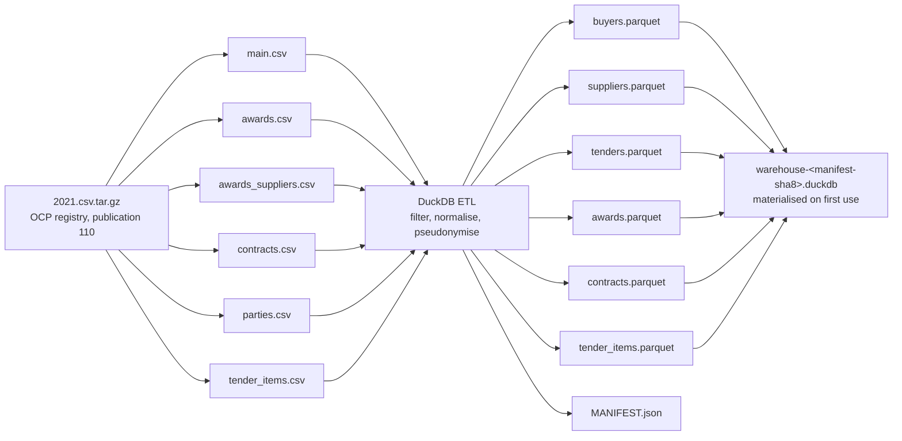

# Datos: SERCOP Ecuador OCDS 2021

El almacén incluido es un extracto filtrado, normalizado y pseudonimizado del sistema de compras
públicas de Ecuador (SERCOP) de 2021. Se distribuye como seis archivos Parquet más
`MANIFEST.json` dentro del wheel, así que la aplicación funciona sin conexión en la primera
ejecución.

> Contiene datos del SERCOP, Ecuador (https://datosabiertos.compraspublicas.gob.ec),
> CC BY 3.0 EC; filtrados, normalizados, pseudonimizados.

## Fuente y licencia

| Campo | Valor |
|---|---|
| Editor | Servicio Nacional de Contratación Pública (SERCOP), Ecuador |
| Conjunto de datos | Datos masivos OCDS, variante CSV, año 2021 |
| Distribución | Open Contracting Partnership Data Registry, publicación 110 |
| URL | https://data.open-contracting.org/en/publication/110/download?name=2021.csv.tar.gz |
| Licencia | CC BY 3.0 Ecuador — https://creativecommons.org/licenses/by/3.0/ec/ |
| Enlace de atribución | https://datosabiertos.compraspublicas.gob.ec |
| SHA-256 del tarball | `e1fbc3c855a4c85f2077542cbce977ab5ac882fc11744f7042bc81d5a8f426fe` |

La política de publicación del editor (sección 6) permite el uso y la redistribución con
cualquier fin, siempre que se incluya un enlace a la fuente original. La política también excluye
los números de teléfono, el tamaño del proveedor y el presupuesto de referencia SIE; este paquete
no contiene esos campos.

El tarball se regenera en el origen de vez en cuando, así que el fijado reproducible es el SHA-256
de los seis miembros CSV consumidos:

| Miembro | Registros CSV | SHA-256 |
|---|---:|---|
| `main.csv` | 122,277 | `eb3c05fdf955dbd3879e372f3e6ce54f7f8b199efd45bb355d754aeba3e53f00` |
| `awards.csv` | 121,736 | `2622dbe34c5ab30a6b93de76b817884ad19484ee6557957faf8e73897beefe4d` |
| `awards_suppliers.csv` | 121,736 | `cbfaae3cf405fccf72d4de9e31003b96ee19323eb5f7bd0e31965d194fe0d4ab` |
| `contracts.csv` | 117,492 | `6d944118c5d0876279033dd39e9c842df20be759cb5ef4faedc7b720e12b71ee` |
| `parties.csv` | 293,287 | `5da114e85818189bc63b623b6fd2863443247f6097726e72d065054db0cc0da8` |
| `tender_items.csv` | 49,628 | `0844e18c3d1e7b15bbfb63609d1ba83d059c6eab44d83546802803c7a5ae0fe8` |

## Paquete

| Tabla | Filas | SHA-256 del Parquet |
|---|---:|---|
| `buyers` | 2,641 | `66f7e1f6cde4f95ee205fd91936fa8c367bf8f7c2d4557c2ef1894234f8f49d0` |
| `suppliers` | 10,217 | `e054a56a78f9a0cbe84f6e069b7b37d6e0b89d8797ad5689111dce9e4d64e95a` |
| `tenders` | 121,072 | `f3abd034f4ce111da656a655beace09e7af1130db33eab7fe155c28db06684e6` |
| `awards` | 121,736 | `1102c411fd998c9612915ad87dafb263b3998593d8268cd64b4788ba421846bf` |
| `contracts` | 117,492 | `f64cb7185bd8845fa0ab4e9e79055cd0a6b3f1c4dd30449287190044a5a29936` |
| `tender_items` | 49,628 | `d4317aac062ab31d1258a57529ca602c5e7a3d771594a510f509ad30bb40460a` |

El tamaño total de los Parquet es de unos 4.3 MB (muy por debajo del presupuesto de 8 MB). Cada
archivo usa zstd nivel 19, se escribe desde una sesión de DuckDB de un solo hilo y se ordena por su
clave para que las reconstrucciones sean reproducibles. `MANIFEST.json` además registra los conteos
de filas y las huellas (suma de la columna monetaria en centavos y conteo de claves distintas);
`sqlagent data verify` recalcula todos ellos.

## Linaje



## Esquema

```
buyers(buyer_id PK, buyer_name, province, canton)
suppliers(supplier_id PK, supplier_name, supplier_kind, province, canton)
tenders(tender_id PK, process_code, release_date, buyer_id FK→buyers, title,
        description, procurement_method, procurement_type, method_details,
        category, status, planned_amount_usd, number_of_tenderers, is_competitive)
awards(tender_id FK→tenders, award_id, supplier_id FK→suppliers, amount_usd,
       status, PK(tender_id, award_id))
contracts(contract_id, tender_id FK→tenders, award_id, status, amount_usd,
          signed_date, duration_days)
tender_items(item_id PK, tender_id FK→tenders, description, quantity, unit_name,
             unit_price_usd, cpc_code, cpc_description)
```

Parquet no incluye restricciones. En el primer uso, el materializador crea en el directorio de
datos del usuario una base de datos DuckDB de solo lectura con las claves primarias y foráneas
declaradas; una prueba comprueba que no haya filas huérfanas.

## Reglas del ETL

1. Lee los seis CSV como `VARCHAR` (`all_varchar=true`, `sample_size=-1`).
2. Conserva solo las filas de `main` con un `tender_status` no NULL (descarta 1,205 publicaciones
   solo de planificación).
3. Normaliza cada cadena: recorta los espacios y reduce cada secuencia de espacios a uno.
4. `tenders.tender_id` es el `ocid` de OCDS; `process_code` son los dos tokens separados por
   guiones que siguen al prefijo `ocds-<publisher>-` (`ocds-5wno2w-CE-20210001947751-115480` →
   `CE-20210001947751`).
5. `buyer_id` es el RUC de 13 dígitos extraído de `EC-RUC-…`; la provincia y el cantón del
   comprador provienen de su fila en `parties`.
6. `procurement_type` es un mapeo cerrado: Catálogo electrónico → `catalogo_electronico`;
   Subasta Inversa Electrónica → `subasta_inversa`; Menor Cuantía → `menor_cuantia`; Cotización →
   `cotizacion`; las tres variantes de contratación directa → `contratacion_directa`; Contratos
   entre Entidades Públicas → `entre_entidades_publicas`; cualquier otro valor → `otros`.
7. El tipo de proveedor sigue al tercer dígito del RUC: 0–5 persona natural, 6 entidad pública,
   9 empresa; en otro caso, otro.
8. Las adjudicaciones se restringen a las licitaciones retenidas y se unen a una única fila de
   proveedor; los contratos son `SELECT DISTINCT` sobre las columnas proyectadas; los ítems y los
   contratos siguen a su licitación retenida.
9. Cada tabla se ordena por su clave y se escribe con zstd nivel 19.
10. El manifiesto guarda la URL de origen, los hashes y las filas de los miembros, los hashes, las
    filas, las huellas de las tablas, las versiones de las herramientas y la marca de tiempo de
    construcción.

## Privacidad

* 6,086 proveedores personas naturales (tercer dígito del RUC 0–5) se pseudonimizan de forma
  determinista: `PN-000001`, `PN-000002`, … en orden de RUC, con el nombre visible
  `Persona natural PN-000001`. La provincia y el cantón se conservan para el análisis agregado. El
  paquete no contiene ningún nombre ni RUC de persona natural.
* 96 identificadores heredados de proveedor en el origen carecen del prefijo `EC-RUC-` (empiezan
  con `ID-` y mezclan números con formato de cédula y de RUC). Sus adjudicaciones se vinculan a un
  único proveedor `ID-UNKNOWN` de tipo `other`, con un nombre neutro. Así se evita publicar
  identificadores no verificables y se mantienen intactos el contrato del proveedor fijado de
  10,217 filas y todas las claves foráneas de adjudicación.
* Una prueba recorre cada columna `VARCHAR` de los Parquet confirmados buscando RUC de personas
  naturales y comprueba que cada nombre `natural_person` tenga el prefijo `Persona natural PN-`. El
  límite del escaneo ignora deliberadamente los códigos de proceso de OCDS separados por guiones,
  que contienen secuencias de 13 dígitos que no son RUC.
* Los campos de texto libre se truncan (`description` 240, descripción del ítem 160, descripción
  CPC 120) para mantener acotados los prompts y el paquete.

## Particularidades

* No hay licitaciones publicadas en junio de 2021; en noviembre de 2021 solo se publicaron 216.
* `contracts.signed_date` es NULL en alrededor del 90% de los contratos; usa
  `tenders.release_date` para el análisis temporal.
* `planned_amount_usd` es NULL en todas las filas de Subasta Inversa (SERCOP excluye ese
  presupuesto por política), y las compras por catálogo electrónico con frecuencia no tienen valor
  de contrato; usa `awards.amount_usd` para el gasto.
* Alrededor del 87% de las licitaciones son micro-compras por catálogo electrónico; la mediana del
  monto planificado es de unos 62 USD.
* `contracts` tiene identificadores de origen repetidos; se deduplica de forma intencional y no
  tiene clave primaria.
* Los valores de origen están en español (`goods` se asigna a `bienes`, `works` a `obras`, …).

## Reconstrucción

El paquete confirmado es la fuente de verdad. Para reconstruirlo a partir de los CSV de origen
fijados:

```bash
uv run sqlagent data build --year 2021 --out src/sqlagent/resources/warehouse
uv run sqlagent data verify
```

`data build` descarga el tarball, verifica los hashes de los seis miembros y escribe los archivos
Parquet más `MANIFEST.json`. Si el origen regeneró el archivo y los hashes de los miembros
cambiaron, revisa la diferencia y usa `--allow-checksum-drift`; los nuevos hashes quedan registrados
en el manifiesto (y deben copiarse aquí y al plan). Las pruebas y los benchmarks nunca necesitan
la red.

Para inspeccionar el paquete sin materializar una base de datos:

```bash
uv run sqlagent data info
```
